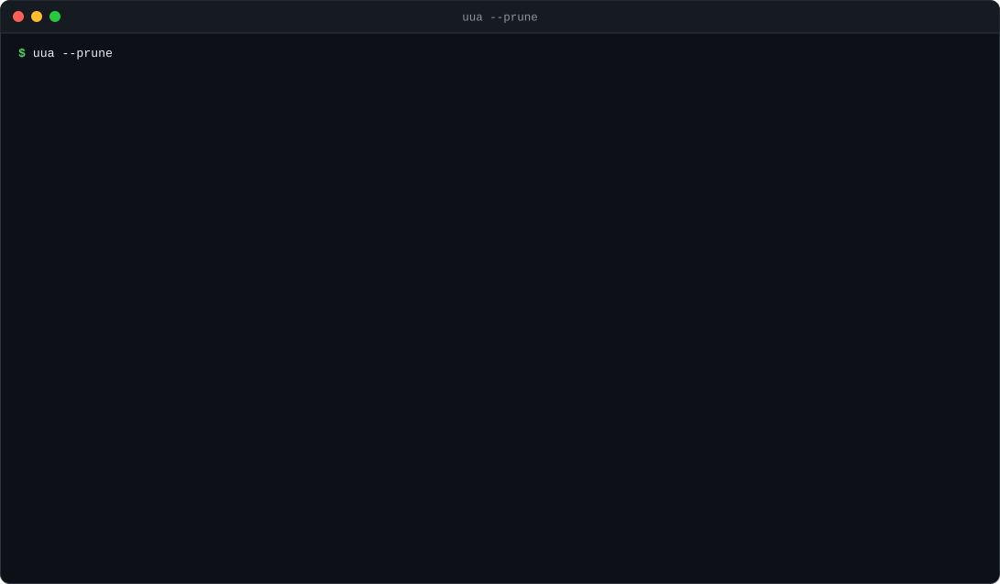

# UUA — Universal Update All

English | [简体中文](README_zh.md)

Update APT packages, Node.js, npm, Bun, global npm/bun packages, Rust toolchains, and AI coding CLIs in one parallel run.



## What It Updates

- **System**: APT packages on Debian/Ubuntu (`apt-get update` & `upgrade`)
- **Node.js & Bun**: Latest Node.js LTS via `nvm` (respecting pinned `default` aliases), `npm`, `bun`, and global registry packages (`npm -g`, `bun -g`)
- **Rust**: `rustup` and tracked toolchains (`stable`, `beta`, `nightly`, etc.; pinned versions and `cargo install` binaries are left untouched)
- **AI Coding CLIs**: Claude Code (`claude`), Codex (`codex`), Antigravity (`agy`), OpenCode (`opencode`), and Pi (`pi` + extensions)

Tools that are not installed on your machine are silently skipped. Independent steps run in parallel on a live terminal progress board (or print one summary line per job when piped or logged). `sudo` is requested once up front, and only when the APT group runs (outside `--check`).

## Requirements

- **Linux** with `zsh` 5.0+, `curl`, `flock` (`util-linux`), and `timeout` (`coreutils`).
- macOS is not supported.

## Install

Run as your normal user (not with `sudo`):

```sh
curl -fsSL https://raw.githubusercontent.com/roy-tian/uua/master/install.sh | sh
```

The installer places `uua` in `~/.local/bin/uua`, installs missing runtime dependencies via APT on Debian/Ubuntu if needed, and adds `~/.local/bin` to `PATH` in `.bashrc`, `.zshrc`, or `.profile` (shells like Fish need manual `PATH` configuration).

- **Upgrade UUA**: Run the same install command again.
- **Uninstall**: `rm ~/.local/bin/uua`

### From a Git Checkout

```sh
make install     # installs to ~/.local/bin/uua (override with PREFIX=/usr/local)
make uninstall
```

## Usage

```sh
uua                 # update everything installed
uua --check         # check for available updates without changing anything (no sudo)
uua --prune         # also remove superseded versions and unused APT packages
uua --apt           # only APT packages
uua --node          # only node, npm, bun, and global npm/bun packages
uua --rust          # only rustup and Rust toolchains
uua --ai            # only AI coding CLIs
uua --verbose       # stream live command output above the board
uua --keep-logs     # keep run logs in ~/.local/state/uua/ (kept automatically on failure)
uua --no-color      # disable colors (NO_COLOR is also respected)
uua --help          # full option and behavior reference
```

- **Combine filters**: Group flags can be combined freely (e.g., `uua --apt --ai`).
- **Safe cleanup (`--prune`)**: Nothing is removed unless `--prune` is passed. With `--prune`, UUA removes Node.js releases older than the current LTS (keeping `default` and any release used by a running process), older standalone Codex releases, and unused APT packages (`apt-get autoremove`). Rust toolchains are never removed.
- **Safe interruption (`Ctrl-C`)**: Cancels active jobs and pending APT downloads immediately; if `dpkg` is already running, UUA waits for it to finish safely.

### Exit Codes

| Code | Meaning |
|------|---------|
| `0` | Everything is up to date or was updated |
| `1` | A step failed, or another `uua` run is already active |
| `2` | Invalid command-line option |
| `100` | Updates are available (`--check`) |
| `130` | Interrupted with `Ctrl-C` |

## Development

```sh
make link        # symlink ./uua to ~/.local/bin/uua
make demo        # preview the live board on a fake system (SPEED=0.5 for faster playback)
make test        # run syntax checks and offline test suite
```

`make demo` and `make test` require `node` on `PATH`.

## License

MIT — see [LICENSE](LICENSE).
