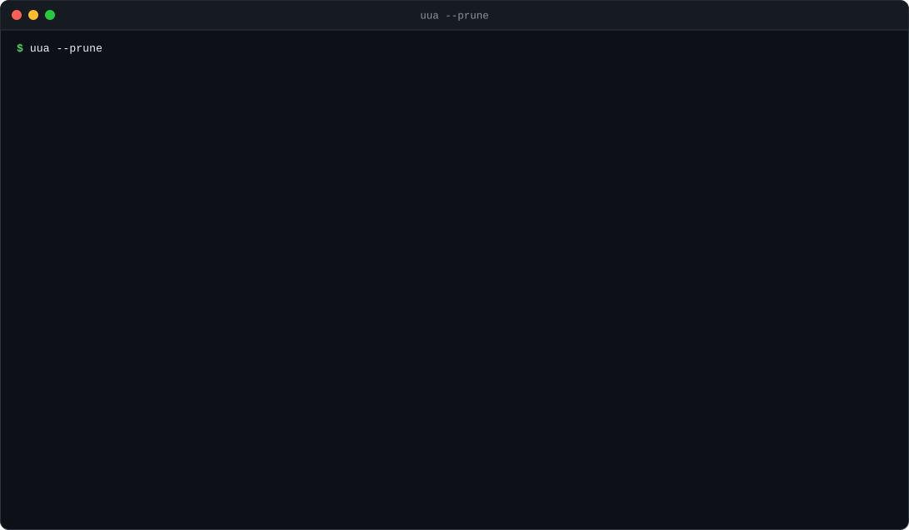

# UUA — Universal Update All

[English](README.md) | 简体中文

一条命令并行更新 APT 软件包、Node.js、npm、Bun、npm/bun 全局包、Rust 工具链以及常用 AI 编程 CLI。



## 支持更新的内容

- **系统软件包**：Debian/Ubuntu 上的 APT 软件包（`apt-get update` 与 `upgrade`）
- **Node.js 与 Bun**：通过 `nvm` 更新最新 Node.js LTS（保留手动固定的 `default` 别名）、`npm`、`bun` 以及全局包（`npm -g`、`bun -g`）
- **Rust**：`rustup` 及其管理的工具链（`stable`、`beta`、`nightly` 等；固定版本的工具链与 `cargo install` 二进制文件保持不变）
- **AI 编程 CLI**：Claude Code（`claude`）、Codex（`codex`）、Antigravity（`agy`）、OpenCode（`opencode`）、Pi（`pi` 及其扩展）

未安装的工具会自动静默跳过。互不依赖的任务会并行执行，并在终端实时展示进度面板（管道或日志环境下则按任务逐行输出）。仅在运行 APT 分组时（`--check` 除外）才会在启动前提示输入一次 `sudo` 密码。

## 环境要求

- **Linux** 系统，需具备 `zsh` 5.0+、`curl`、`flock`（`util-linux`）和 `timeout`（`coreutils`）。
- 不支持 macOS。

## 安装

以普通用户身份运行（请勿加 `sudo`）：

```sh
curl -fsSL https://raw.githubusercontent.com/roy-tian/uua/master/install.sh | sh
```

安装脚本会将 `uua` 安装到 `~/.local/bin/uua`，在 Debian/Ubuntu 上按需通过 APT 补齐运行依赖，并将 `~/.local/bin` 写入 `.bashrc`、`.zshrc` 或 `.profile` 的 `PATH`（Fish 等其他 Shell 需手动配置 `PATH`）。

- **升级 UUA**：再次运行上方安装命令即可。
- **卸载**：`rm ~/.local/bin/uua`

### 从源码目录安装

```sh
make install     # 安装到 ~/.local/bin/uua（可通过 PREFIX=/usr/local 指定前缀）
make uninstall
```

## 使用方法

```sh
uua                 # 更新所有已安装项
uua --check         # 仅检查可用更新，不执行安装或清理（无需 sudo）
uua --prune         # 更新后一并清理被替代的旧版本与无用 APT 包
uua --prune-only    # 仅执行清理，不更新任何内容（可与分组参数组合）
uua --apt           # 仅更新 APT 软件包
uua --node          # 仅更新 node、npm、bun 及全局包
uua --rust          # 仅更新 rustup 与 Rust 工具链
uua --ai            # 仅更新 AI 编程 CLI
uua --verbose       # 在进度面板上方实时输出各命令日志
uua --keep-logs     # 保留本次运行日志于 ~/.local/state/uua/（失败时默认保留）
uua --no-color      # 禁用彩色输出（同样支持 NO_COLOR 环境变量）
uua --help          # 查看完整选项与详细说明
```

- **组合筛选**：分组参数可自由组合（例如 `uua --apt --ai`）。
- **安全清理（`--prune` / `--prune-only`）**：不加 `--prune` 时不会删除任何内容；启用后会清理早于当前 LTS 的旧版 Node.js（保留 `default` 指向的版本及正在被进程占用的版本）、旧版 Codex 独立发行包以及无用的 APT 依赖（`apt-get autoremove`），不会删除任何 Rust 工具链。`uua --prune-only` 仅执行这套清理而不做任何更新；支持同样的分组参数，`--check --prune-only` 则只报告会删除什么。
- **安全中断（`Ctrl-C`）**：立即停止运行中的任务与未完成的 APT 下载；若 APT 已进入 `dpkg` 安装阶段，UUA 会等待其安全结束。

### 退出码

| 退出码 | 含义 |
|--------|------|
| `0` | 全部已是最新或已完成更新 |
| `1` | 存在失败任务，或已有另一个 `uua` 实例正在运行 |
| `2` | 命令行参数无效 |
| `100` | 检测到可用更新（`--check`）；配合 `--prune-only` 时表示检测到可清理项 |
| `130` | 用户通过 `Ctrl-C` 中断 |

## 本地开发

```sh
make link        # 将 ./uua 软链接至 ~/.local/bin/uua
make demo        # 在模拟环境中演示实时面板（可设 SPEED=0.5 加快播放）
make test        # 运行语法检查与离线测试套件
```

运行 `make demo` 与 `make test` 需确保 `node` 在 `PATH` 中。

## 许可证

MIT — 详见 [LICENSE](LICENSE)。
